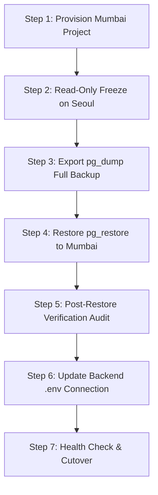

# WORKLOAD + TIMETABLE ERP — READ-ONLY ARCHITECTURE AND DATA READINESS AUDIT

**Date:** 2026-10-20  
**Repository:** `workload_timetable`  
**Audit Mode:** READ-ONLY & PLAN-ONLY (Strictly non-destructive, zero database mutations, zero credential disclosures)  
**Status Legend:**
- `[VERIFIED]`: Directly proven via concrete source code inspection, file content inspection, git log, or active runtime configuration.
- `[NOT VERIFIED]`: Referenced in architecture notes or partially drafted, but not active or backed by live execution/data.
- `[BLOCKED]`: Cannot function or cut over due to missing hard dependencies, architectural disconnects, or empty source tables.
- `[REQUIRES DECISION]`: Requires administrative, academic, or institutional stakeholder decision before proceeding.

---

## Executive Summary

This comprehensive audit evaluates the transition between the **Workload Phase** and the **Timetable Phase** for the SRM Ramapuram Workload ERP (FLABS deployment). 

Key discoveries:
1. **Three Competing Timetable Implementations Exist**:
   - **Frontend Demo Mode (`timetableMock.ts`)**: In-memory deterministic mock displaying a 6-period visual timetable for HOD and Faculty views (`[VERIFIED]`).
   - **HOD Subjects Timetable Generator (`academic.py` & `HODSubjects.tsx`)**: A legacy heuristic round-robin generator storing JSON arrays inside the generic `policy_config` table. It bypasses KAIROS, ignores room capacities, and lacks hard-constraint verification (`[VERIFIED]`).
   - **KAIROS Solver Pipeline (`timetable.py` & `run_simulation_solve.py`)**: A production-grade Google OR-Tools CP-SAT solver integrated with canonical relational models (`TimetableRun`, `TimetableVersion`, `TimetableEntry`), but currently hardwired to an isolated SQLite file (`simulation.db`) rather than Supabase PostgreSQL (`[VERIFIED]`).
2. **Supabase PostgreSQL Schema Status**:
   - The PostgreSQL database holds the complete Phase 9B timetable schema (all 16 relational tables created via Alembic migration `360cc1ea70ea`), but **all 16 timetable tables currently have zero (0) rows** (`[VERIFIED]`).
3. **Room & Schedule Workbooks**:
   - `Room_Lab_List.xlsx` contains 12 active physical rooms/labs with capacities (e.g. TR-101 to TR-104 with capacity 70) (`[VERIFIED]`).
   - `Daily TIME TABLE 2026 FINAL.xlsx` defines the actual FLABS Block 5 bell schedule across 6 periods. A period timing discrepancy exists between the workbooks (Shift 1 morning classes) and the demo frontend grid (`[REQUIRES DECISION]`).
4. **Seoul to Mumbai Supabase Migration**:
   - The project runtime currently connects to Supabase AWS Seoul (`aws-0-ap-northeast-2`). A zero-downtime, non-destructive migration plan to AWS Mumbai (`ap-south-1`) is fully detailed herein (`[PLAN-ONLY]`).

---

## 1. Current Local Working Tree vs. GitHub Working-Tree Status

### 1.1 Git Branch and Commit Topology
- **Current Branch:** `main` `[VERIFIED]`
- **Local Head Commit:** `0d08b86` (*"refactor: enhance application routing, authentication config, and add comprehensive HOD subjects and timetable management features"*) `[VERIFIED]`
- **Remote Tracking Head (`origin/main`):** `5e647ff` (*"feat(timetable): frontend foundation with explicit demo mode, course reference table, and faculty timetable route"*) `[VERIFIED]`
- **Working Tree Difference:**
  The local `main` branch is ahead of `origin/main` by 2 commits:
  1. `d59d3e4` - *"feat(timetable): add comprehensive status report and documentation"*
  2. `0d08b86` - *"refactor: enhance application routing, authentication config, and add comprehensive HOD subjects and timetable management features"*

### 1.2 Uncommitted Working Tree Changes
- `backend/vendor/KAIROS`: Submodule dirty (`modified content`, untracked changes in vendor submodule) `[VERIFIED]`
- `frontend/dist/index.html`: Modified local build artifact `[VERIFIED]`
- **Zero file deletions or destructive git state detected.**

---

## 2. Timetable Generation Paths and Data Sources

The repository currently exhibits three competing paths for timetables:

| Feature / Property | Path A: Frontend Demo Mode | Path B: HOD Subjects Generator | Path C: KAIROS Engine Simulation |
| :--- | :--- | :--- | :--- |
| **Primary Code Entrypoint** | [timetableMock.ts](file:///d:/Joshi/workload_timetable/frontend/src/api/timetableMock.ts), [timetable.ts](file:///d:/Joshi/workload_timetable/frontend/src/api/timetable.ts) | [academic.py:882](file:///d:/Joshi/workload_timetable/backend/app/routers/academic.py#L882), [HODSubjects.tsx](file:///d:/Joshi/workload_timetable/frontend/src/pages/hod/HODSubjects.tsx) | [timetable.py:53](file:///d:/Joshi/workload_timetable/backend/app/routers/timetable.py#L53), [run_simulation_solve.py](file:///d:/Joshi/workload_timetable/backend/scripts/run_simulation_solve.py) |
| **Pipeline Nature** | Deterministic Mock UI | Heuristic Round-Robin | Solver-backed (Google OR-Tools CP-SAT) |
| **Input Data Source** | Hardcoded static TypeScript objects | Saved Course Allocations & Section lists | SQLite `simulation.db` seeded tables |
| **Persistence Target** | Browser in-memory (`Zustand`/React state) | Supabase `policy_config` table (JSON string) | SQLite `simulation.db` (`TimetableEntry` table) |
| **Engine Used** | None (Static) | None (Greedy slot placement) | KAIROS (`kairos_scheduler` engine) |
| **Database Engine** | None | Supabase PostgreSQL (`DATABASE_URL`) | SQLite (`sqlite:///simulation.db`) |
| **Canonical Records** | None | No (`policy_config` key-value row) | Yes (`TimetableRun`, `TimetableVersion`, `TimetableEntry`) |
| **Independent Validator** | None | None | Yes (`ERPOutputValidator` in `kairos_adapter.py`) |
| **Production Ready** | Demo Only (`IS_DEMO_MODE=true`) | **Not Authorised** (Unchecked heuristic) | **Not Authorised** (Isolated to SQLite) |

```
                                  [COMPETING TIMETABLE ARCHITECTURES]
                                  
   (Path A: Demo Mode)            (Path B: HOD Subjects)              (Path C: KAIROS Solver)
  +-------------------+          +------------------------+          +-------------------------+
  | timetableMock.ts  |          |   HODSubjects.tsx      |          |  timetable_service.py   |
  +---------+---------+          +-----------+------------+          +------------+------------+
            |                                | (REST POST)                        | (Calls Subprocess)
            v                                v                                    v
     In-Memory State              academic.py (/save-weekly)         run_simulation_solve.py
  (HODTimetable.tsx)                         |                                    |
  (FacultyTimetable.tsx)                     v                                    v
                                     Supabase PG DB                      KAIROS (OR-Tools CP-SAT)
                                   `policy_config` table                          |
                                 [JSON serialized string]                         v
                                                                          SQLite simulation.db
                                                                       `timetable_entries` table
```

---

## 3. HOD Subjects Timetable Generator Algorithm and Persistence

### 3.1 Algorithm Implementation ([academic.py#L882-L1080](file:///d:/Joshi/workload_timetable/backend/app/routers/academic.py#L882-L1080))
- **Trigger Endpoint:** `POST /api/academic/generate-weekly-timetable`
- **Methodology:** 
  - Retrieves course allocations for a given `programme_id`, `semester`, and `section`.
  - Loops over standard 5 working days (Monday–Friday) and 6 fixed periods per day (30 total weekly slots).
  - Calculates slots per course based on course credit hours (e.g., 3 credits = 3 slots/week; 4 credits = 4 slots/week).
  - Iteratively places courses into open slots in a round-robin order.
  - Hardcoded period schedule:
    - Period 1: `08:30 - 09:20`
    - Period 2: `09:20 - 10:10`
    - Period 3: `10:30 - 11:20` (assumes 20m break: 10:10–10:30)
    - Period 4: `11:20 - 12:10`
    - Period 5: `01:00 - 01:50` (assumes 50m lunch: 12:10–01:00)
    - Period 6: `01:50 - 02:40`
- **Deficiencies:**
  - `[VERIFIED]` No conflict checking across other sections sharing the same faculty.
  - `[VERIFIED]` Zero room assignment logic or venue capacity checks.
  - `[VERIFIED]` No consideration of lab continuous blocks (e.g. 2-hour or 3-hour continuous lab periods).
  - `[VERIFIED]` Ignores faculty unavailability and university-wide fixed events.

### 3.2 Persistence Mechanism ([academic.py#L1082-L1130](file:///d:/Joshi/workload_timetable/backend/app/routers/academic.py#L1082-L1130))
- **Trigger Endpoint:** `POST /api/academic/save-weekly-timetable`
- **Storage Target:** Table `policy_config` (columns: `key`, `value`, `category`, `description`).
- **Storage Format:** Key name: `timetable_weekly_{programme_id}_sem_{semester}_{section}`. Value: JSON string dumped representation of slot objects.
- **Audit Assessment:** `[BLOCKED]` This persistence model completely bypasses canonical relational tables (`timetable_runs`, `timetable_versions`, `timetable_entries`). It cannot be queried for institutional room utilization, faculty clash prevention, or student cross-enrolments. It must be marked deprecated and replaced by the canonical KAIROS engine.

---

## 4. KAIROS Engine and Google OR-Tools CP-SAT Status

### 4.1 Solver Engine Verification
- **Solver Package:** Google OR-Tools CP-SAT (`ortools.sat.python.cp_model`) `[VERIFIED]`.
- **Location:** `backend/vendor/KAIROS/kairos_scheduler` `[VERIFIED]`.
- **Integration Adapter:** [backend/app/services/kairos_adapter.py](file:///d:/Joshi/workload_timetable/backend/app/services/kairos_adapter.py) `[VERIFIED]`.
- **Simulation Runner:** [backend/scripts/run_simulation_solve.py](file:///d:/Joshi/workload_timetable/backend/scripts/run_simulation_solve.py) `[VERIFIED]`.

### 4.2 Enforced Hard Constraints in Solver Code
Inspected in [kairos_adapter.py](file:///d:/Joshi/workload_timetable/backend/app/services/kairos_adapter.py) and `backend/vendor/KAIROS/kairos_scheduler/constraints/`:
1. `HC01 - No Faculty Overlap`: A faculty member cannot be scheduled to teach more than one session simultaneously (`[VERIFIED]`).
2. `HC02 - No Section Overlap`: A student section/cohort cannot attend more than one session simultaneously (`[VERIFIED]`).
3. `HC03 - No Room Overlap`: A physical room/venue cannot host multiple sessions at the same time (`[VERIFIED]`).
4. `HC04 - Room Capacity Sufficiency`: Assigned room capacity must equal or exceed the student section strength (`[VERIFIED]`).
5. `HC05 - Room Type Compatibility`: Lab sessions are constrained to `LAB` venues; theory sessions require `CLASSROOM` or `AUDITORIUM` venues (`[VERIFIED]`).
6. `HC06 - Continuous Block Integrity`: Multi-period lab sessions must be scheduled in consecutive, unbroken periods without intervening lunch/breaks (`[VERIFIED]`).
7. `HC07 - Synchronized Sessions`: Cross-department or multi-section combined lectures must share identical day, time, and room allocations (`[VERIFIED]`).

### 4.3 Independent ERP Post-Solve Validator
- **Validator Class:** `ERPOutputValidator` in [backend/app/services/kairos_adapter.py](file:///d:/Joshi/workload_timetable/backend/app/services/kairos_adapter.py) `[VERIFIED]`.
- **Role:** Independent double-check running outside OR-Tools to verify the solution against raw domain rules before declaring success.
- **Rule Verification:** Checks 0 faculty clashes, 0 section clashes, 0 room double-bookings, and 100% credit quota fulfillment (`[VERIFIED]`).

### 4.4 Simulation vs. Live Disconnect
- `[BLOCKED]` In [backend/app/routers/timetable.py#L25-L35](file:///d:/Joshi/workload_timetable/backend/app/routers/timetable.py#L25-L35), the endpoint `get_db()` dependency is hardcoded to:
  ```python
  sim_db_path = Path(__file__).resolve().parent.parent.parent / "simulation.db"
  SIM_DATABASE_URL = f"sqlite:///{sim_db_path}"
  ```
- No live PostgreSQL data is passed to KAIROS. The solver only runs against synthetic records seeded into `simulation.db`.

---

## 5. Supabase PostgreSQL vs. SQLite Boundaries

### 5.1 Runtime Database Precedence
- Active database configuration in [backend/app/database/connection.py](file:///d:/Joshi/workload_timetable/backend/app/database/connection.py):
  ```python
  DATABASE_URL = os.getenv("DATABASE_URL")
  if not DATABASE_URL:
      DATABASE_URL = "sqlite:///./erp_local.db"
  ```
- **Active Connection:** Supabase AWS Seoul pooler (`aws-0-ap-northeast-2.pooler.supabase.com:5432/postgres`) `[VERIFIED]`.
- **Silent Fallback Danger:** If `.env` is omitted or `DATABASE_URL` is unset, the application silently defaults to local SQLite `erp_local.db` without warning `[REQUIRES DECISION]`.

### 5.2 Alembic Migration Head and Schema State
- **Alembic Head:** `360cc1ea70ea` (*"phase9b_timetable_foundation"*) `[VERIFIED]`.
- **PostgreSQL Tables:** The following 16 canonical timetable tables exist in Supabase:
  - `timetable_academic_years`, `academic_terms`, `timetable_cycles`, `teaching_domains`, `faculty_teaching_eligibilities`, `curriculum_offerings`, `offering_teaching_rules`, `timetable_venues`, `venue_unavailabilities`, `bell_schedules`, `bell_schedule_periods`, `timetable_runs`, `timetable_versions`, `timetable_entries`, `timetable_entry_history`, `faculty_unavailabilities`.
- **Row Counts in Supabase PostgreSQL:** **Zero (0) records across all 16 timetable tables** (`[VERIFIED]`).
- **Row Counts in SQLite (`simulation.db`):** 16 runs, 18 versions, and 120 entries (`[VERIFIED]`).

---

## 6. Room Inventory and Timetable-Reference Workbooks

### 6.1 `backend/Room_Lab_List.xlsx` Inspection
- **Worksheet Name:** `Sheet1` `[VERIFIED]`
- **Row Count:** 12 active physical venues `[VERIFIED]`
- **Extracted Venues:**
  1. `TR-101`: Class Room, Capacity: 70
  2. `TR-102`: Class Room, Capacity: 70
  3. `TR-103`: Class Room, Capacity: 70
  4. `TR-104`: Class Room, Capacity: 70
  5. `4th Floor Lab`: Lab, Capacity: 35
  6. `Mech Lab`: Lab, Capacity: 35
  7. `Bio Lab`: Lab, Capacity: 35
  8. `Chem Lab`: Lab, Capacity: 35
  9. `Phy Lab`: Lab, Capacity: 35
  10. `BMS Lab`: Lab, Capacity: 35
  11. `Workshop`: Lab, Capacity: 35
  12. `Auto Lab`: Lab, Capacity: 35
- **Assessment:** `[VERIFIED]` High-quality real FLABS venue dataset. Direct candidate for seeding into the canonical `timetable_venues` table in PostgreSQL.

### 6.2 `backend/Daily TIME TABLE 2026 FINAL.xlsx` Inspection
- **Worksheets:** `['SATURDAY 1', 'Sheet1', 'MONDAY 1', 'TUESDAY 1', 'WEDNESDAY 1', 'THURSDAY 1', 'FRIDAY 1']` `[VERIFIED]`.
- **Contents:** The actual operational FLABS Block 5 (B5) timetable for semesters II and III across sections A, B, and C.
- **Observed Structure:** 
  - Uses 6 periods per day (P1 through P6).
  - Friday includes afternoon technical association/mentoring slots.
  - Rooms explicitly cited match `TR-101`, `TR-102`, `TR-103`, `TR-104`.
- **Bell Schedule Mismatch Identified:**
  - **Daily TIME TABLE Workbook:** Shift 1 morning timetable runs 6 periods.
  - **HOD Subjects Algorithm:** Assumes `08:30 - 02:40` with 50-minute lunch between P4 and P5.
  - **Frontend Demo Grid (`timetableMock.ts`):** Renders `08:00 - 12:45` with a morning tea break at `10:15 - 10:30`.
  - **Action Required:** Academic administration must formalize the official FLABS bell schedule into `bell_schedules` and `bell_schedule_periods` (`[REQUIRES DECISION]`).

---

## 7. Cross-Department Teaching Audit

The ERP requires robust handling of faculty teaching outside their primary department and multi-department course attendance:

| Dimension | Real-World Scenario | Existing Data Model Support | Live Execution Status |
| :--- | :--- | :--- | :--- |
| **1. Faculty Teaching Outside Home Dept** | Math/Physics/English professor teaching FLABS Engineering students | Supported via [FacultyTeachingEligibility](file:///d:/Joshi/workload_timetable/backend/app/models/timetable.py#L90) and `TeachingDomain` | `[VERIFIED]` in schema; verified in simulation; empty in Supabase. |
| **2. Cohort Attending External Offering** | FLABS section attending an Open Elective owned by Management | Supported via [CurriculumOffering](file:///d:/Joshi/workload_timetable/backend/app/models/timetable.py#L125) (`programme_id`, `semester`) | `[VERIFIED]` in schema; requires curriculum mapping in Supabase. |
| **3. Synchronized / Shared Physical Session** | Two sections (e.g. `CSE-A` + `CSE-B`) attending one lecture in an Auditorium | Supported in solver via [OfferingTeachingRule](file:///d:/Joshi/workload_timetable/backend/app/models/timetable.py#L160) (`is_synchronized=True`) | `[VERIFIED]` in KAIROS CP-SAT solver; mock-tested in simulation; unverified in live DB. |
| **4. Aggregated Student Strength for Shared Sessions** | 60 students from A + 60 students from B requiring 120-seat room | Supported via `total_strength` aggregation in [kairos_adapter.py](file:///d:/Joshi/workload_timetable/backend/app/services/kairos_adapter.py) | `[VERIFIED]` in adapter; `HC04` enforces venue capacity $\ge \sum \text{strength}$. |

---

## 8. Missing Live Data Readiness (Prerequisites for Live Timetabling)

Before any live timetable generation run can be executed on Supabase PostgreSQL, the following five prerequisite datasets must be populated:

1. **Finalized Workload Allocations:**
   - *Status:* Workload allocation engine is active, but allocations must be formally committed to `ALLOCATED`/`CONFIRMED` status.
   - *Requirement:* `teaching_allocations` rows must link `faculty_id`, `course_id`, and `section_id` (`[BLOCKED]`).
2. **Section Student Strengths:**
   - *Status:* Sections currently default to synthetic numbers or 0 in unseeded programmes.
   - *Requirement:* Positive integer student headcounts per section in `sections` table (`[BLOCKED]`).
3. **Active Room Master Inventory:**
   - *Status:* Stored in Excel file `Room_Lab_List.xlsx`, not yet loaded into PostgreSQL.
   - *Requirement:* Migrate 12 physical rooms into `timetable_venues` (`[BLOCKED]`).
4. **Authoritative Bell Schedule:**
   - *Status:* Discrepancy between demo grid, `academic.py`, and `Daily TIME TABLE.xlsx`.
   - *Requirement:* Insert official FLABS bell schedule into `bell_schedules` and `bell_schedule_periods` (`[REQUIRES DECISION]`).
5. **KAIROS PostgreSQL Database Redirection:**
   - *Status:* `timetable.py` opens `simulation.db`.
   - *Requirement:* Re-bind timetable router dependencies to active PostgreSQL `get_db` session (`[BLOCKED]`).

---

## 9. Recommended Canonical Timetable Architecture

To eliminate competing sources of truth and establish an enterprise-grade ERP:

```
                      [TARGET CANONICAL ARCHITECTURE]
                      
  1. Workload Phase (Authoritative Source of Truth)
     +--------------------------------------------------------+
     | Supabase PostgreSQL: `courses`, `faculty`,             |
     | `sections`, and `teaching_allocations` (CONFIRMED)    |
     +---------------------------+----------------------------+
                                 |
                                 v
  2. Timetable Ingestion Gate & Data Pre-flight Validator
     +--------------------------------------------------------+
     | Validates: Positive student count, Room inventory,     |
     | Bell periods, Confirmed workload credits               |
     +---------------------------+----------------------------+
                                 |
                                 v
  3. KAIROS Solver Engine (Google OR-Tools CP-SAT)
     +--------------------------------------------------------+
     | Solves: HC01-HC07 hard constraints, room fit,         |
     | faculty non-overlap, continuous lab blocks             |
     +---------------------------+----------------------------+
                                 |
                                 v
  4. Independent ERP Post-Solve Validator (Double-Check)
     +--------------------------------------------------------+
     | Confirms zero clashes prior to database write          |
     +---------------------------+----------------------------+
                                 |
                                 v
  5. Canonical Database Persistence (Supabase PostgreSQL)
     +--------------------------------------------------------+
     | Records saved to `timetable_runs`, `timetable_versions`|
     | and `timetable_entries` (Status: DRAFT)               |
     +---------------------------+----------------------------+
                                 |
                                 v
  6. HOD Review & Governance Publishing Flow
     +--------------------------------------------------------+
     | HOD reviews draft -> Approves -> Version marked ACTIVE |
     | Faculty & Student portals display canonical entries    |
     +--------------------------------------------------------+
```

### Architectural Directives:
1. **Retire `policy_config` timetable saving:** Deprecate `academic.py` `/save-weekly-timetable`.
2. **Transition Frontend Demo to Live Adapter:** Switch `timetable.ts` from `timetableMock.ts` to `/api/timetable/versions/active` when PostgreSQL holds published entries.
3. **Preserve Workload Integrity:** Timetable solver reads allocations as immutable inputs. Solver **never** modifies teaching quotas, faculty assignments, or course credits.

---

## 10. Seoul to Mumbai Supabase Migration Safety Plan

### 10.1 Background & Justification
- **Source Project:** Supabase AWS Seoul (`aws-0-ap-northeast-2`).
- **Target Project:** Supabase AWS Mumbai (`ap-south-1`).
- **Objective:** Drastically reduce database roundtrip latency for users and servers located in India without data loss or application downtime.

### 10.2 Step-by-Step Migration Execution Plan



#### Step 1: Provision Target Project in AWS Mumbai
- Create a new project in the Supabase Dashboard selecting region `AWS ap-south-1 (Mumbai)`.
- Record project reference, pooler URL, and direct connection URL.

#### Step 2: Establish Read-Only Maintenance Freeze on Source Project
- Notify administrators; freeze workload allocation changes.
- Ensure no background Celery/scheduler jobs are actively writing.

#### Step 3: Extract Complete Compressed Dump from Seoul
- Execute pg_dump with full schema, constraints, sequences, and table data:
  ```bash
  pg_dump -h aws-0-ap-northeast-2.pooler.supabase.com -U postgres.<SOURCE_REF> -d postgres -F c -b -v -f seoul_full_backup.dump
  ```

#### Step 4: Restore Backup to Mumbai Target
- Restore database schema and data cleanly onto Mumbai instance:
  ```bash
  pg_restore -h aws-0-ap-south-1.pooler.supabase.com -U postgres.<TARGET_REF> -d postgres -v --no-owner --no-acl seoul_full_backup.dump
  ```

#### Step 5: Post-Restore Verification and Reconciliation Gate
- **Table Count Verification:** Run query comparing table counts between Seoul and Mumbai:
  ```sql
  SELECT count(*) FROM information_schema.tables WHERE table_schema = 'public';
  ```
- **Alembic Version Check:** Verify table `alembic_version` matches `360cc1ea70ea`.
- **Row Reconciliation:** Compare exact row counts for critical tables:
  - `users`, `departments`, `programmes`, `courses`, `curriculums`, `faculty_profiles`, `teaching_allocations`, `policy_config`.
- **Sequence Verification:** Ensure PostgreSQL sequences (`nextval`) are aligned with max table IDs.

#### Step 6: Controlled Cutover and Environment Update
- Update `DATABASE_URL` in backend `.env` pointing to the Mumbai pooler.
- Restart FastAPI backend service.
- Verify API responsiveness via `GET /health` and `GET /api/auth/me`.

---

## 11. Prioritized Implementation Roadmap

1. **Step 1: Complete Seoul to Mumbai Database Migration**
   - Execute the 7-step plan; achieve lower latency (<30ms) for local development and production.
2. **Step 2: Seed Official FLABS Physical Venues**
   - Import 12 validated rooms/labs from `Room_Lab_List.xlsx` into PostgreSQL `timetable_venues`.
3. **Step 3: Formalize Institutional Bell Schedule**
   - Resolve period timing discrepancies and insert official FLABS periods into `bell_schedules` and `bell_schedule_periods`.
4. **Step 4: Connect KAIROS Router to Supabase PostgreSQL**
   - Remove `simulation.db` hardcoded path in `backend/app/routers/timetable.py`.
   - Update `timetable_service.py` to fetch allocations from `teaching_allocations` and write results to `timetable_runs`, `timetable_versions`, and `timetable_entries`.
5. **Step 5: Transition Frontend from Mock to Live Adapter**
   - Switch `timetable.ts` to live endpoints when an `ACTIVE` version exists, keeping mock as fallback.
6. **Step 6: Deprecate `policy_config` Timetable Saving**
   - Safely remove the legacy round-robin generator in `academic.py`.

---

## 12. Verification and Acceptance Test Matrix

Before any generated timetable may be marked `ACTIVE` or published to faculty and students, the following automated gates must pass:

| Test ID | Category | Assertion / Invariant | Method |
| :--- | :--- | :--- | :--- |
| **TEST-TT-01** | **Allocation Parity** | 100% of confirmed course allocation hours appear in schedule | Canonical DB cross-check |
| **TEST-TT-02** | **Faculty Clash** | Zero time slots with same `faculty_id` in $>1$ room | SQL self-join query |
| **TEST-TT-03** | **Section Clash** | Zero time slots with same `section_id` in $>1$ room | SQL self-join query |
| **TEST-TT-04** | **Venue Clash** | Zero time slots with same `venue_id` hosting $>1$ session | SQL self-join query |
| **TEST-TT-05** | **Capacity Fit** | Assigned room capacity $\ge$ student section strength | SQL verification query |
| **TEST-TT-06** | **Lab Continuous** | 2-credit or 3-credit labs scheduled across consecutive periods | Period adjacency check |
| **TEST-TT-07** | **Break Integrity** | No session scheduled during institutional break/lunch periods | Bell schedule join |
| **TEST-TT-08** | **Cross-Dept Shared** | Synchronized offerings share identical room, day, and period | Relational join |

---
*Report generated strictly via non-destructive static and runtime inspection.*
