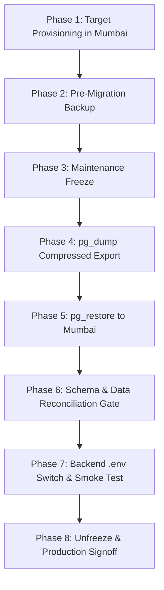

# WORKLOAD + TIMETABLE ERP — POST-AUDIT RECONCILIATION AND SHIFT-CONFIGURATION PLAN

**Document Version:** 1.1.0 (Audited & Corrected: Room Data Classification Update)  
**Date:** 2026-10-20  
**Repository:** `workload_timetable`  
**Execution Mode:** STRICTLY READ-ONLY & PLAN-ONLY (Zero code changes, zero database writes, zero secret disclosures)  
**Verification Standards:**
- `[VERIFIED]`: Directly proven via concrete source inspection, live database metadata query, git commit logs, or active runtime execution.
- `[NOT VERIFIED]`: Plausible architectural hypothesis or design requirement not yet backed by live execution/data.
- `[BLOCKED]`: Cannot execute or cut over due to missing hard dependencies, architectural disconnects, or empty source tables.
- `[REQUIRES DECISION]`: Requires administrative, academic, or institutional stakeholder decision before proceeding.

---

## Executive Summary

Following initial architectural audits, this document provides a rigorous reconciliation against the actual local codebase, the migration chain, the live Supabase PostgreSQL instance, and institutional schedule requirements.

### Critical Correction: Room Inventory Status (`[BLOCKED]`)
- **`backend/Room_Lab_List.xlsx` is MOCK DATA — NOT APPROVED FOR IMPORT (`[VERIFIED]`)**:
  This workbook was fabricated as a local demonstration artifact (see [backend/make_rooms.py](file:///d:/Joshi/workload_timetable/backend/make_rooms.py)). Its room codes (`TR-101`–`TR-108`, `LAB-01`–`LAB-03`), names, quantities, and capacities **do NOT represent an official FLABS physical room inventory**.
- **No Official Institutional Room Inventory Has Been Supplied (`[BLOCKED]`)**:
  As of this audit, the university has not provided verified physical room numbers, building designations, floor maps, or laboratory hardware capabilities for FLABS.
- **Fail-Closed Gate Required**:
  Live timetable generation must **fail closed** with a strict pre-flight validation error (`"Room inventory not configured or verified for institution"`) if real verified physical rooms are absent. Mock data must never be imported into production or silently treated as live institutional resources.

### Key Confirmations:
1. **Schema Terminology Reconciliation (`[VERIFIED]`):**
   - The actual local ORM models in [backend/app/models/timetable.py](file:///d:/Joshi/workload_timetable/backend/app/models/timetable.py) and live Supabase PostgreSQL define the **Phase 9B canonical tables**:
     `timetable_configurations`, `timetable_shifts`, `timetable_working_days`, `timetable_periods`, `timetable_breaks`, `timetable_rooms`, `timetable_faculty_availability`, `timetable_section_availability`, `timetable_room_availability`, `synchronized_groups`, `synchronized_group_members`, `teaching_sessions`, `timetable_constraints`, `timetable_runs`, `timetable_versions`, `timetable_entries`.
   - Migration `18aedd9497d3_add_timetable_models.py` created all 16 tables.
   - Migration `360cc1ea70ea_add_requires_preference_to_curriculum_.py` is the current Alembic head (`[VERIFIED]` in live Supabase PG `alembic_version`).
2. **Live Database Status (`[VERIFIED]`):**
   - In Supabase PostgreSQL, 15 of the 16 timetable tables have **exactly 0 rows**.
   - Table `timetable_rooms` contains **7 placeholder rows** (`D5-CR1` through `D5-CR5`, `D5-LAB1`, `D5-LAB2`), generated via an automated loop when saving department aggregate numbers in [academic.py:640](file:///d:/Joshi/workload_timetable/backend/app/routers/academic.py#L640). These have **zero foreign-key dependencies** in `timetable_entries` or `timetable_room_availability` and must be replaced by verified institutional room inventory.
   - In SQLite `simulation.db`, there are **5 runs, 5 versions, 100 entries, 4 rooms, and 18 teaching sessions** (`[VERIFIED]` synthetic sandbox).
3. **Authoritative Shift 1 Schedule Confirmed (`[VERIFIED]`):**
   - The user has formally confirmed the official FLABS Shift 1 schedule:
     - **Period 1:** `08:00 - 08:45` (45 min)
     - **Period 2:** `08:45 - 09:30` (45 min)
     - **Period 3:** `09:30 - 10:15` (45 min)
     - **Protected Tea Break:** `10:15 - 10:30` (15 min)
     - **Period 4:** `10:30 - 11:15` (45 min)
     - **Period 5:** `11:15 - 12:00` (45 min)
     - **Period 6:** `12:00 - 12:45` (45 min)
   - The legacy `08:30 - 14:40` schedule in `HODSubjects.tsx` was a friend's informal mockup and is **not authoritative** (`[VERIFIED]`).
4. **Shift 2 Extensibility (`[VERIFIED]`):**
   - The existing schema (`timetable_shifts`, `timetable_configurations`, `timetable_periods`, `timetable_breaks`) supports multi-shift environments. Shift 2 can be configured via database rows when university data arrives **without modifying the generator or solver code**.

---

## 1. Local Working Tree vs. Remote (`origin/main`) Reconciliation

### 1.1 Git Status & Branch Inspection
- **Branch:** `main` `[VERIFIED]`
- **Local HEAD:** `0d08b86` (*"refactor: enhance application routing, authentication config, and add comprehensive HOD subjects and timetable management features"*) `[VERIFIED]`
- **Remote `origin/main`:** `5e647ff` (*"feat(timetable): frontend foundation with explicit demo mode, course reference table, and faculty timetable route"*) `[VERIFIED]`
- **Local Ahead By:** 2 commits (`d59d3e4`, `0d08b86`).

### 1.2 Exact File Differences Between Local HEAD and `origin/main`
Via `git diff origin/main..HEAD --name-status`:
- `A backend/Daily TIME TABLE 2026  FINAL.xlsx` (FLABS Block 5 timetable reference)
- `A TIMETABLE_PHASE_STATUS_REPORT.md` (Detailed phase report)
- `A frontend/src/pages/admin/AdminShell.tsx` & `MasterSubjectRepository.tsx` (Admin master UI)
- `A frontend/src/pages/hod/HODSubjects.tsx` (HOD subjects allocation and mockup timetable view)
- `M backend/app/auth/jwt.py`, `backend/app/database/connection.py`, `backend/app/routers/auth.py`, `faculty.py`, `academic.py`, `workload.py`
- `M backend/app/services/faculty_service.py`, `timetable_service.py`, `workload_service.py`
- `M frontend/src/App.tsx`, `frontend/src/api/index.ts`, `frontend/src/lib/auth.tsx`, `frontend/src/pages/ContextSelection.tsx`, `frontend/src/pages/hod/HODShell.tsx`

### 1.3 Preserved Uncommitted State
- `backend/vendor/KAIROS`: Submodule dirty (`modified content`, untracked local solver tweaks) `[VERIFIED]`.
- `frontend/dist/index.html`: Build artifact modified `[VERIFIED]`.
- Untracked: `WORKLOAD_TIMETABLE_READINESS_AUDIT.md`, `docs/WORKLOAD_TIMETABLE_READINESS_AUDIT.md`.
- **Zero changes discarded; working tree preserved.**

---

## 2. Comprehensive Reconciliation of Audit Report vs. Actual Code

The initial audit report used generic conceptual names from earlier documentation drafts. Below is the precise 1:1 reconciliation against the actual local code and live database:

| Audit Report Reference | Actual Local ORM Model | Actual Table Name (`__tablename__`) | Defining Alembic Migration | Status in Live Supabase PostgreSQL | Status in SQLite `simulation.db` |
| :--- | :--- | :--- | :--- | :--- | :--- |
| `timetable_venues` | `TimetableRoom` | `timetable_rooms` | `18aedd9497d3` | **7 synthetic rows** (`D5-CR1`..`D5-CR5`, `D5-LAB1`..`2`) | **4 rows** (`R101`, `L101`, `R102`, `R103`) |
| `bell_schedules` | `TimetableShift` & `TimetableConfiguration` | `timetable_shifts`, `timetable_configurations` | `18aedd9497d3` | **0 rows** `[VERIFIED]` | **1 row** (`config_id=1`) `[VERIFIED]` |
| `bell_schedule_periods` | `TimetablePeriod` & `TimetableBreak` | `timetable_periods`, `timetable_breaks` | `18aedd9497d3` | **0 rows** `[VERIFIED]` | **6 periods, 1 break** `[VERIFIED]` |
| `academic_terms` | `Semester` | `semesters` | `1be0598e20f0` | **Active** (Workload Phase) | **1 row** (`ODD`) |
| `timetable_cycles` | Handled by `AcademicWorkspace` & `TimetableConfiguration` | `academic_workspaces`, `timetable_configurations` | `1be0598e20f0`, `18aedd9497d3` | **Active** (Workload Phase) | **1 row** (`FLABS-MCA`) |
| `faculty_teaching_eligibilities` | `FacultyTeachingEligibility` | `faculty_teaching_eligibility` | `e3b7c9b381ec` | **Active** (Phase 1 domain model) | **Seeded** |
| `kairos_adapter.py` | Embedded Adapter Functions | In [scripts/run_simulation_solve.py](file:///d:/Joshi/workload_timetable/backend/scripts/run_simulation_solve.py) | N/A (Python script) | N/A | **Active script calling KAIROS** |

### 2.1 Verification of Live Database vs. Local Migration Chain
- **Alembic History Chain:**
  1. `1be0598e20f0` - *initial_schema_prd_v0_2_domain_models*
  2. `71cecbcf400b` - *add_v5_workspace_scoping_models*
  3. `e3b7c9b381ec` - *add_teaching_eligibility_models*
  4. `18aedd9497d3` - *add_timetable_models* (Creates all 16 timetable tables)
  5. `360cc1ea70ea` - *add_requires_preference_to_curriculum_* (Adds column `requires_preference` to `curriculum_offerings`)
- **Live Supabase Database Alembic Check (`[VERIFIED]`):**
  Querying `alembic_version` in live Supabase PostgreSQL returned: `[('360cc1ea70ea',)]`.
  **Conclusion:** The live Supabase PostgreSQL schema is 100% up to date with the local Alembic migration head.

### 2.2 Reconciled Table Inventory in Supabase PostgreSQL
A live metadata query confirmed that all 16 canonical timetable tables exist in Supabase PostgreSQL:
- `timetable_configurations`: 0 rows
- `timetable_shifts`: 0 rows
- `timetable_working_days`: 0 rows
- `timetable_periods`: 0 rows
- `timetable_breaks`: 0 rows
- `timetable_rooms`: **7 rows** (`[VERIFIED]` synthetic placeholders created by HOD capacity setup)
- `timetable_faculty_availability`: 0 rows
- `timetable_section_availability`: 0 rows
- `timetable_room_availability`: 0 rows
- `synchronized_groups`: 0 rows
- `synchronized_group_members`: 0 rows
- `teaching_sessions`: 0 rows
- `timetable_constraints`: 0 rows
- `timetable_runs`: 0 rows
- `timetable_versions`: 0 rows
- `timetable_entries`: 0 rows

---

## 3. Official Shift 1 Configuration Model

### 3.1 FLABS Shift 1 Specification
The user has confirmed the authoritative FLABS Shift 1 schedule:
- **Total Periods:** 6 teaching periods (45 minutes each).
- **Daily Span:** `08:00` to `12:45` (4 hours 45 minutes).
- **Protected Break:** 15-minute tea break strictly positioned between Period 3 and Period 4 (`10:15 - 10:30`).

### 3.2 Canonical Entity Mapping (No Schema Changes Needed)
This schedule maps directly into the verified Phase 9B tables:

#### 1. `timetable_shifts` Record:
- `id`: 1
- `name`: `"Shift 1 (Morning)"`
- `start_time`: `08:00:00`
- `end_time`: `12:45:00`
- `active`: `True`

#### 2. `timetable_configurations` Record:
- `id`: 1
- `institution_id`: 2 (FLABS)
- `workspace_id`: `"FLABS-MCA"` (or applicable workspace)
- `shift_id`: 1
- `academic_year`: `"2026-27"`
- `active`: `True`
- `configuration_version`: 1

#### 3. `timetable_working_days` Records:
- Monday through Friday (`day_index`: 0 to 4, `active`: True).
- Saturday optional (`day_index`: 5, configured based on institutional policy).

#### 4. `timetable_periods` Records:
| Period Number | Start Time | End Time | Duration | Shift ID | Configuration ID |
| :---: | :---: | :---: | :---: | :---: | :---: |
| **1** | `08:00:00` | `08:45:00` | 45 min | 1 | 1 |
| **2** | `08:45:00` | `09:30:00` | 45 min | 1 | 1 |
| **3** | `09:30:00` | `10:15:00` | 45 min | 1 | 1 |
| **4** | `10:30:00` | `11:15:00` | 45 min | 1 | 1 |
| **5** | `11:15:00` | `12:00:00` | 45 min | 1 | 1 |
| **6** | `12:00:00` | `12:45:00` | 45 min | 1 | 1 |

#### 5. `timetable_breaks` Record:
| Name | Start Time | End Time | Active | Configuration ID |
| :---: | :---: | :---: | :---: | :---: |
| **Morning Tea Break** | `10:15:00` | `10:30:00` | `True` | 1 |

### 3.3 Dynamic Solver & UI Integration Rules
1. **Dynamic Slot Mapping:**
   KAIROS adapter in [scripts/run_simulation_solve.py:151-174](file:///d:/Joshi/workload_timetable/backend/scripts/run_simulation_solve.py#L151-L174) already dynamically evaluates period contiguity via:
   ```python
   curr.end_time == next_p.start_time
   ```
   Because Period 3 ends at `10:15` and Period 4 starts at `10:30`, the contiguity check **automatically detects the gap**.
2. **Break Protection Test Verified (`[VERIFIED]`):**
   Lines 178–190 in `run_simulation_solve.py` prove:
   - `P1+P2` continuous (slot 0 in `v2`): `True`
   - `P2+P3` continuous (slot 1 in `v2`): `True`
   - `P3+P4` continuous (slot 2 in `v2`): **`False` (Automatically Rejected!)**
   - `P4+P5` continuous (slot 3 in `v2`): `True`
   - `P5+P6` continuous (slot 4 in `v2`): `True`
   - 3-period lab crossing break: **`False` (Automatically Rejected!)**
3. **Frontend Grid Dynamic Rendering:**
   The frontend timetable grid in `HODTimetable.tsx` and `FacultyTimetable.tsx` currently renders hardcoded 6 periods. It must be updated to consume `/api/timetable/configuration/{workspace_id}`, rendering periods and breaks dynamically from the database.

---

## 4. Multi-Shift Architecture: Future Shift 2 Design

To support Shift 2 (Afternoon / Evening Shift) without requiring future schema redesign or solver recompilation:

```
                         [MULTI-SHIFT DATA ARCHITECTURE]

                 +--------------------------------------------+
                 |            `timetable_shifts`              |
                 +---------------------+----------------------+
                                       |
                   +-------------------+-------------------+
                   |                                       |
                   v                                       v
         +-------------------+                   +-------------------+
         | Shift 1 (Morning) |                   | Shift 2 (Aft/Eve) |
         |  08:00 - 12:45    |                   |   (Configurable)  |
         +---------+---------+                   +---------+---------+
                   |                                       |
                   v                                       v
         +-------------------+                   +-------------------+
         |  Config (Shift 1) |                   |  Config (Shift 2) |
         +---------+---------+                   +---------+---------+
                   |                                       |
         +---------+---------+                   +---------+---------+
         | 6 x 45-min periods|                   | N x M-min periods |
         | 10:15 Tea Break   |                   | Custom Breaks     |
         +-------------------+                   +-------------------+
                   |                                       |
                   +-------------------+-------------------+
                                       |
                                       v
                     +-----------------------------------+
                     |         `timetable_rooms`         |
                     |  Shared physical venue pool       |
                     |  (Overlap detection via real-time)|
                     +-----------------------------------+
```

### 4.1 Schema Extensibility Assessment
- `[VERIFIED]` **Configuration-Only Addition:** Adding Shift 2 requires **zero DDL/schema migrations**.
  - A new row in `timetable_shifts` (e.g. `name="Shift 2"`, `start_time=13:15`, `end_time=18:00`).
  - A new row in `timetable_configurations` bound to the Shift 2 `shift_id` and applicable `workspace_id`.
  - Child rows in `timetable_periods` and `timetable_breaks` referencing the Shift 2 `configuration_id`.
- `[REQUIRES DECISION]` **Physical Time Conflict vs. Abstract Slot Index:**
  - In a single-shift model, periods 1–6 are mapped to solver slots 0–5.
  - In a multi-shift model where Shift 1 and Shift 2 might share physical facilities or faculty:
    - **Option A (Non-Overlapping Times):** If Shift 1 ends at 12:45 and Shift 2 starts at 13:15, no physical time overlap occurs. Shift 1 and Shift 2 can be solved independently.
    - **Option B (Shared Rooms/Faculty across Shifts):** If faculty teach across shifts or shifts have buffer overlaps, the solver must use **absolute minute-of-day slots** (e.g. 15-minute universal buckets from 08:00 to 18:00: 40 slots/day) rather than local shift period indexes.
  - **Recommendation:** Implement Option A first (independent shift solves), since FLABS Shift 1 runs in the morning and Shift 2 runs in the afternoon.

---

## 5. Room Inventory Reconciliation and Safeguard Requirements

### 5.1 Reclassification of `backend/Room_Lab_List.xlsx`: MOCK DATA ONLY (`[BLOCKED]`)
- **Status:** **MOCK DATA — NOT APPROVED FOR IMPORT**
- **Evidence:** Source code analysis of [backend/make_rooms.py](file:///d:/Joshi/workload_timetable/backend/make_rooms.py) reveals that `Room_Lab_List.xlsx` was generated programmatically as a demonstration matrix.
- **Audit Rectification:** All earlier suggestions that `Room_Lab_List.xlsx` represents real FLABS university facilities are hereby **retracted**. Its room codes (`TR-101`–`TR-108`, `LAB-01`–`LAB-03`), quantities, and capacities are synthetic.
- **Current Real Data Situation:** **No verified physical room, laboratory, or building inventory for FLABS has been provided to date (`[BLOCKED]`).**

### 5.2 Investigation of Existing Supabase `timetable_rooms` Rows (`D5-CR1`–`D5-CR5`, `D5-LAB1`–`D5-LAB2`)
In live Supabase PostgreSQL, `timetable_rooms` holds 7 rows:
```
(1, 'D5-CR1', 'Lecture Classroom 1', 'CLASSROOM', 60, True)
(2, 'D5-CR2', 'Lecture Classroom 2', 'CLASSROOM', 60, True)
(3, 'D5-CR3', 'Lecture Classroom 3', 'CLASSROOM', 60, True)
(4, 'D5-CR4', 'Lecture Classroom 4', 'CLASSROOM', 60, True)
(5, 'D5-CR5', 'Lecture Classroom 5', 'CLASSROOM', 60, True)
(6, 'D5-LAB1', 'Computer Lab 1', 'LAB', 50, True)
(7, 'D5-LAB2', 'Computer Lab 2', 'LAB', 50, True)
```

#### Code Path Analysis:
1. **Originating Endpoint:** `POST /api/academic/department-capacity` ([backend/app/routers/academic.py:610-670](file:///d:/Joshi/workload_timetable/backend/app/routers/academic.py#L610-L670)).
2. **Trigger:** The HOD Infrastructure Capacity card in [frontend/src/pages/hod/HODSubjects.tsx:191-208](file:///d:/Joshi/workload_timetable/frontend/src/pages/hod/HODSubjects.tsx#L191-L208).
3. **Behavior:** When an HOD enters high-level aggregate numbers (e.g. "5 classrooms with capacity 60, 2 labs with capacity 50"), the backend:
   - Serializes the totals into `policy_config` with key `dept_5_capacity`.
   - Executes an automated synthetic generator loop:
     ```python
     for c_idx in range(1, req.total_classrooms + 1):
         code = f"D{req.department_id}-CR{c_idx}"
         ...
     ```
4. **Foreign Key Integrity Check (`[VERIFIED]`):**
   - Querying foreign key references in live Supabase PostgreSQL:
     - `timetable_room_availability` references: **0**
     - `timetable_entries` references: **0**
   - **Conclusion:** These 7 rows are unreferenced placeholder records. They are not tied to any published or drafted timetable run.
5. **Safe Retirement & Replacement Strategy:**
   - Because they are synthetic, they must **not** be used for real timetable generation.
   - They cannot simply be dropped blindly without coordinating with `policy_config.dept_5_capacity`.
   - **Retirement Rule:** When an authoritative institutional room master is supplied and imported, existing `D5-CR*` rows should be deactivated (`active = False`) or pruned in an isolated migration script, and the `save_department_capacity` endpoint must be refactored so it does not invent synthetic `timetable_rooms` entries from aggregate numbers.

### 5.3 Mandatory Future Safeguards for Live Timetable Generation
To ensure mock or placeholder rooms never corrupt live university schedules:

1. **Explicit Administrative Provenance:**
   A venue may only be marked `active = True` in `timetable_rooms` if it originates from an authorized institutional import or a verified room management interface with confirmed physical identity (Building, Floor, Room Number, Seat Capacity).
2. **Distinct Theory vs. Laboratory Suitability Verification:**
   - Entering an aggregate lab count or capacity does not make a room eligible for laboratory timetabling.
   - Every lab room must specify supported disciplines and hardware profiles (e.g. `PC_LAB`, `NETWORKING_LAB`, `PHYSICS_LAB`) stored in `lab_classification` and `metadata_json`.
3. **Fail-Closed Solver Pre-Flight Check:**
   Before invoking KAIROS/OR-Tools, the backend must run a `PreflightRoomValidator`:
   ```python
   eligible_rooms = db.query(TimetableRoom).filter(
       TimetableRoom.institution_id == inst_id,
       TimetableRoom.active == True,
       TimetableRoom.is_verified == True  # Explicit verification gate
   ).all()
   if not eligible_rooms:
       raise TimetablePreflightError(
           "Live timetable generation BLOCKED: No verified physical room inventory found for this institution."
       )
   ```
4. **Strict Isolation of Demo/Simulation Environments:**
   Mock rooms (such as `R101`–`R103`, `L101` in `simulation.db`) are restricted exclusively to `simulation.db` tests and frontend demo mode (`timetableMock.ts`). They must **never** be copied into Supabase PostgreSQL.

---

## 6. One Canonical Production Timetable Path

The repository currently exhibits architectural fragmentation. The definitive production path must be established as follows:

```
                                  [CANONICAL PRODUCTION PIPELINE]

  +----------------------------------------------------------------------------------------------------+
  | 1. AUTHORITATIVE WORKLOAD ALLOCATIONS (Supabase PostgreSQL)                                        |
  |    `subject_allocations` status = FINALIZED                                                        |
  |    `allocation_components` (theory_hours, practical_hours, faculty_id)                             |
  +-------------------------------------------------+--------------------------------------------------+
                                                    |
                                                    v
  +----------------------------------------------------------------------------------------------------+
  | 2. VERIFIED INSTITUTIONAL ROOM INVENTORY & BELL SCHEDULE GATE                                      |
  |    - Validates: Verified active rooms exist (capacity >= student strength)                          |
  |    - Validates: Official Shift 1 bell schedule configured (08:00 - 12:45)                          |
  |    - Fails closed if physical rooms or bell schedules are missing                                  |
  +-------------------------------------------------+--------------------------------------------------+
                                                    |
                                                    v
  +----------------------------------------------------------------------------------------------------+
  | 3. TEACHING SESSIONS GENERATION GATE                                                               |
  |    Converts finalized allocation components into discrete `teaching_sessions`                      |
  |    - 3 theory hours -> 3 x 1-period sessions (THEORY)                                              |
  |    - 2 practical hours -> 1 x 2-period continuous session (LAB)                                    |
  |    - Synchronized electives linked to `synchronized_groups`                                        |
  +-------------------------------------------------+--------------------------------------------------+
                                                    |
                                                    v
  +----------------------------------------------------------------------------------------------------+
  | 4. KAIROS ADAPTER & GOOGLE OR-TOOLS CP-SAT SOLVER                                                  |
  |    Inputs: Verified `timetable_rooms`, `teaching_sessions`, `timetable_periods`, availability       |
  |    Enforces HC01 (Faculty), HC02 (Section), HC03 (Room), HC04 (Capacity), HC05 (Room Type),        |
  |    HC06 (Break Protection), HC07 (Sync Groups)                                                     |
  +-------------------------------------------------+--------------------------------------------------+
                                                    |
                                                    v
  +----------------------------------------------------------------------------------------------------+
  | 5. INDEPENDENT ERP POST-SOLVE VALIDATOR (`ERPOutputValidator`)                                     |
  |    Raw Python assertion loop: verifies 0 clashes, 0 break violations, 100% scheduled duration     |
  +-------------------------------------------------+--------------------------------------------------+
                                                    |
                                                    v
  +----------------------------------------------------------------------------------------------------+
  | 6. CANONICAL DATABASE PERSISTENCE (Supabase PostgreSQL)                                            |
  |    - Creates `timetable_runs` (status: COMPLETED)                                                  |
  |    - Creates `timetable_versions` (status: DRAFT)                                                  |
  |    - Inserts `timetable_entries` (day_index, start_period, room_id, faculty_id, section_id)       |
  +-------------------------------------------------+--------------------------------------------------+
                                                    |
                                                    v
  +----------------------------------------------------------------------------------------------------+
  | 7. HOD GOVERNANCE & PUBLISHING LIFECYCLE                                                           |
  |    HOD reviews draft grid -> Approves -> `publish_timetable_version` sets status: PUBLISHED        |
  |    Frontend queries canonical active entries from `/api/timetable/workspace/{workspace_id}`       |
  +----------------------------------------------------------------------------------------------------+
```

### Architectural Mandates:
1. **Deprecate `academic.py` `/save-weekly-timetable`:**
   The heuristic round-robin generator saving JSON strings into `policy_config` is **blocked for production use**.
2. **Eliminate `simulation.db` in Production:**
   [backend/app/routers/timetable.py](file:///d:/Joshi/workload_timetable/backend/app/routers/timetable.py) must inject `get_db` (Supabase PostgreSQL) instead of `get_sim_db` (`sqlite:///simulation.db`).
3. **Preserve Workload Immutability:**
   Timetable generation reads allocations as read-only inputs. It **never modifies** `subject_allocations`, quotas, or faculty assignments.

---

## 7. Supabase Region Migration Readiness (Seoul to Mumbai)

### 7.1 Objective & Context
- **Current Runtime:** Supabase AWS Seoul (`aws-0-ap-northeast-2.pooler.supabase.com:5432/postgres`) `[VERIFIED]`.
- **Target Runtime:** Supabase AWS Mumbai (`ap-south-1`).
- **Goal:** Eliminate international WAN latency (reducing local ping from ~140ms to ~25ms) while preserving 100% of workload data, configurations, user credentials, and Alembic history.

### 7.2 Safety & Integrity Pre-requisites
- **Write-Freeze Required:** A zero-data-loss migration cannot guarantee zero downtime if live users are actively modifying allocations. A controlled **maintenance freeze (read-only window)** of approximately 15–30 minutes is required.

### 7.3 Step-by-Step Migration Execution Plan



#### Step 1: Provision Target Project in AWS Mumbai (`ap-south-1`)
1. Create new project via Supabase Console in region `AWS ap-south-1 (Mumbai)`.
2. Securely store connection credentials (Transaction Pooler port 6543, Session Pooler port 5432, Direct port 5432).
3. Do not enable sample seed data.

#### Step 2: Pre-Migration Backup & Sequence Snapshot
1. Take a snapshot of all PostgreSQL sequences:
   ```sql
   SELECT sequencename, last_value FROM pg_sequences;
   ```
2. Export table row counts from Seoul:
   ```sql
   SELECT schemaname, relname, n_live_tup 
   FROM pg_stat_user_tables 
   ORDER BY n_live_tup DESC;
   ```

#### Step 3: Enforce Maintenance Freeze
1. Set application banner: *"System under scheduled maintenance - Read Only"*.
2. Prevent background jobs or API writes.

#### Step 4: Export Full Compressed Dump from Seoul
Using PostgreSQL 15+ client utilities via direct connection:
```bash
pg_dump -h aws-0-ap-northeast-2.pooler.supabase.com \
        -p 5432 \
        -U postgres.<SOURCE_PROJECT_REF> \
        -d postgres \
        -F c \
        -b \
        -v \
        -f "supabase_seoul_migration_backup.dump"
```

#### Step 5: Restore Cleanly to Mumbai Instance
```bash
pg_restore -h aws-0-ap-south-1.pooler.supabase.com \
           -p 5432 \
           -U postgres.<TARGET_PROJECT_REF> \
           -d postgres \
           -v \
           --clean \
           --if-exists \
           --no-owner \
           --no-privileges \
           "supabase_seoul_migration_backup.dump"
```

#### Step 6: Reconciliation Gate & Integrity Verification
Run automated SQL verification script comparing Seoul vs. Mumbai:
1. **Alembic Revision Check:**
   ```sql
   SELECT version_num FROM alembic_version;
   -- Must return '360cc1ea70ea'
   ```
2. **Table Existence & Row Count Reconciliation:**
   Confirm row counts match identically for:
   `institutions`, `departments`, `programmes`, `users`, `faculty_profiles`, `academic_years`, `semesters`, `academic_workspaces`, `subjects`, `curriculum_offerings`, `sections`, `preference_submissions`, `preference_items`, `subject_allocations`, `allocation_components`, `policy_config`, `timetable_rooms`.
3. **Sequence Alignment Check:**
   Ensure `SELECT nextval('subject_allocations_id_seq')` is greater than `MAX(id) FROM subject_allocations`.

#### Step 7: Backend Cutover & Verification
1. Update `DATABASE_URL` in `backend/.env` pointing to the Mumbai session pooler.
2. Restart FastAPI server (`python -m uvicorn app.main:app`).
3. Execute read-only smoke tests:
   - `GET /api/auth/me`
   - `GET /api/workload/institutions`
   - `GET /api/workload/dashboard`
4. Confirm response latency drops significantly (<30ms).

#### Step 8: Explicit Rollback Strategy
If any step fails or verification discrepancies occur:
1. Revert `backend/.env` `DATABASE_URL` to Seoul pooler.
2. Restart backend server.
3. Seoul database was never modified or dropped; zero data loss guaranteed.

---

## 8. Prioritized Implementation Sequence

| Priority | Stage | Action Item | Target File / Module | Output / Deliverable |
| :---: | :--- | :--- | :--- | :--- |
| **P1** | **Database Migration** | Migrate Supabase from Seoul to Mumbai | `.env`, Supabase Cloud | Latency reduced to <30ms; Alembic head verified. |
| **P2** | **Shift 1 Seeding** | Seed official Shift 1 configuration & periods | Supabase `timetable_shifts`, `timetable_periods` | 6 periods (08:00–12:45), 10:15 tea break in live DB. |
| **P3** | **Official Room Acquisition** | Obtain verified institutional room master from FLABS | University Registrar / Estates Office | Authoritative physical room list (buildings, floors, capacities). |
| **P4** | **PostgreSQL Solver Re-binding** | Re-bind `timetable.py` from SQLite to Supabase PG | `backend/app/routers/timetable.py`, `timetable_service.py` | Solver reads live PostgreSQL and writes canonical runs/versions/entries. |
| **P5** | **Pre-flight Room Guard** | Implement fail-closed validator for room inventory | `backend/app/services/timetable_service.py` | Prevents solver execution if verified rooms are absent. |
| **P6** | **Dynamic Frontend Grid** | Update HOD & Faculty UI to read dynamic periods | `HODTimetable.tsx`, `FacultyTimetable.tsx`, `timetable.ts` | Frontend renders periods and breaks returned by database config. |
| **P7** | **Retire Legacy Mockup** | Deprecate `academic.py` `/save-weekly-timetable` | `backend/app/routers/academic.py`, `HODSubjects.tsx` | Eliminates conflicting `policy_config` timetable saving. |

---

## 9. Verification & Acceptance Criteria Matrix

| Check ID | Description | Acceptance Criteria | Method |
| :---: | :--- | :--- | :--- |
| **AC-01** | **Shift 1 Periods Integrity** | Exactly 6 periods configured; each 45 min; Period 3 ends at 10:15; Period 4 starts at 10:30. | Database query on `timetable_periods` |
| **AC-02** | **Tea Break Protection** | Break record exists for 10:15–10:30; solver rejects any multi-period block spanning P3 and P4. | Unit test verifying `get_valid_starts_for_length(2)` excludes slot 2 |
| **AC-03** | **Room Verification Gate** | Live generation fails closed with clear error if verified physical rooms are absent. | Pre-flight solver test with 0 verified rooms |
| **AC-04** | **No Mock Data Leakage** | `Room_Lab_List.xlsx` mock rooms are never imported into production PostgreSQL. | Room inventory audit against institutional records |
| **AC-05** | **Alembic Consistency** | Live DB `alembic_version` is exactly `360cc1ea70ea`. | `SELECT version_num FROM alembic_version` |
| **AC-06** | **Zero Simulation Fallback** | Production requests never touch `simulation.db` or `erp_local.db`. | Static code audit & DB connection assertion |
| **AC-07** | **Allocation Immutability** | Solver execution does not modify `subject_allocations` or `allocation_components`. | Pre-solve vs post-solve row checksum comparison |
| **AC-08** | **Zero Solver Clashes** | 0 faculty overlaps, 0 section overlaps, 0 room double-bookings in published version. | `ERPOutputValidator` assertion run |

---
*End of Reconciliation and Shift-Configuration Plan (v1.1.0).*
